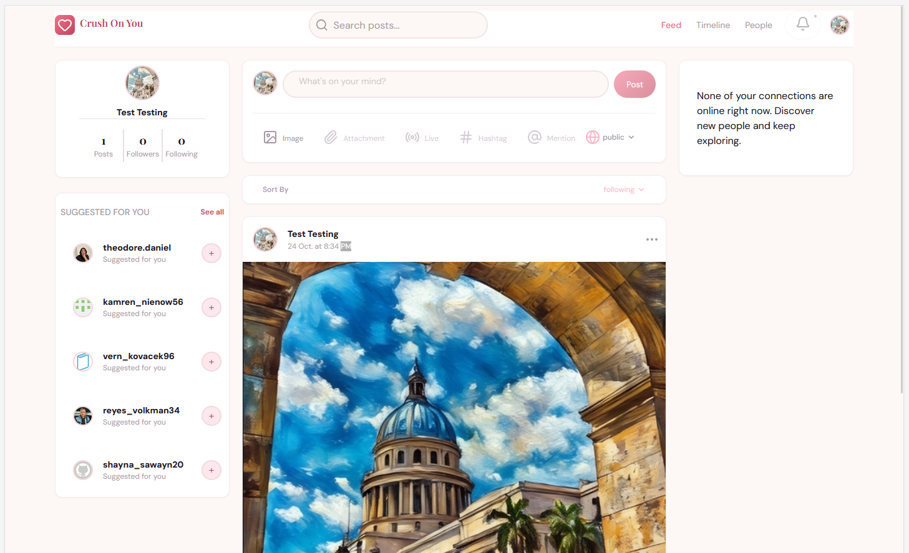
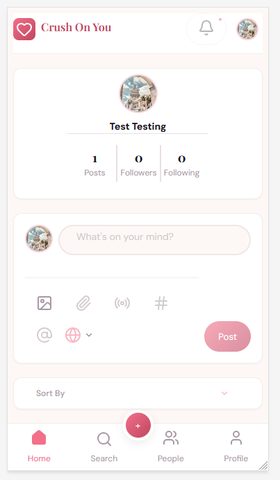
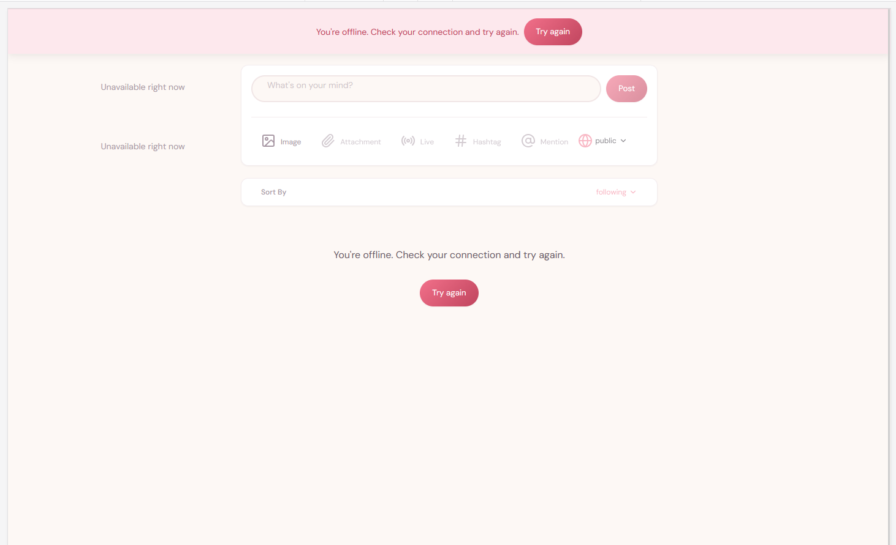

# Crush On You

Aplicación de red social creada como proyecto de portfolio frontend: React 19,
Vite, TanStack Query v5 y React Router v6, sobre una API REST con Node, Express
y MongoDB.

[Read in English](./README.md)

> La documentación está en español, pero la interfaz de la aplicación está en inglés.

<!-- **Demo:**  URL desplegada -->

## Capturas

| Escritorio | Móvil |
|---|---|
|  |  |

Estado sin conexión: un único aviso global, marcadores compactos en los bloques
secundarios y una acción de reintento en el contenido principal.



## Funcionalidades

- **Autenticación:** registro e inicio de sesión con JWT; edición de perfil y subida de avatar.
- **Publicaciones:** crear posts de texto con una imagen, dar like, guardar y borrar los propios.
- **Red social:** seguir y dejar de seguir, listas de seguidores y seguidos, y
  sugerencias (construidas solo con la primera página de usuarios).
- **Feed y timeline:** el feed muestra tus publicaciones y las de las personas que
  sigues; el timeline muestra las publicaciones de un usuario. Ambos usan scroll infinito.
- **Búsqueda:** posts (scroll infinito) y personas (paginada). El texto se guarda
  en la URL, y también la página en los resultados de personas.
- **Diseño responsive:** tres columnas desde 1024px. Por debajo, navegación
  inferior, un botón flotante que abre el editor en un diálogo y un buscador
  desplegable.
- **Estados resilientes:** skeletons, estados vacíos, gestión de sin conexión y
  errores de servidor, y acciones de reintento para la carga de datos.
- **Accesibilidad:** gestión del foco en diálogos y buscador, regiones live,
  navegación por teclado y `aria-expanded` en los controles desplegables.

## Estado del proyecto

Es un proyecto de portfolio, no un producto. Algunas funciones están
desactivadas a propósito con un tooltip de "coming soon" (adjuntos, directo,
hashtags, menciones, notificaciones, visibilidad solo para amigos) porque el
backend no las soporta. Consulta las [limitaciones conocidas](#limitaciones-conocidas).

## Stack tecnológico

| Área | Tecnología |
|---|---|
| UI | React 19, Vite |
| Estado de servidor | TanStack Query v5 (`useInfiniteQuery`, mutaciones optimistas para likes y guardados) |
| Rutas | React Router v6 |
| Estilos | CSS puro: custom properties como tokens de diseño, nomenclatura estilo BEM, mobile-first |
| Tests | Vitest |
| Backend | Node.js, Express, MongoDB Atlas, Cloudinary (de un tutorial, con modificaciones mínimas) |

## Arquitectura

```
pages → components (ui / molecules / organisms) → hooks → services/api → adapters
```

- **Los componentes son presentacionales.** Nunca llaman a TanStack Query ni a
  funciones de la API. Un componente padre consume un hook y pasa datos y
  callbacks hacia abajo.
- **Los hooks absorben la complejidad.** Los hooks de datos viven en `hooks/`.
  Los hooks de orquestación (por ejemplo `usePeoplePage`, `useCreatePostDialog`)
  viven junto a la funcionalidad a la que pertenecen, y pasan a `hooks/` solo
  cuando se vuelven transversales.
- **Los adapters aíslan el backend.** Las formas crudas del backend solo las
  importan los adapters, así que hooks y componentes nunca las ven. No se
  modificó el backend para adaptarlo a la UI: las diferencias se resuelven en el
  frontend.
- **Una única fuente de verdad:** claves de consulta, parámetros de URL (texto
  de búsqueda y página), tokens de diseño y acceso al entorno
  (`services/config.js` es el único archivo que lee `import.meta.env`).

## Decisiones de diseño

- **Errores normalizados.** Todo fallo se convierte en un `ApiError` con un
  código (`NETWORK`, `SERVER`, `INVALID_CREDENTIALS`...). Los mensajes viven en
  un único mapa y nunca se toman de la respuesta del backend, que está en
  español y no tiene códigos de error estables.
- **Los estados de lista tienen una prioridad estricta:** datos en caché, sin
  conexión, error, vacío (solo tras una petición exitosa), carga. Esto eliminó
  los falsos "no hay posts" sin conexión o con una consulta deshabilitada. Una
  excepción documentada: el backend responde `404` para un usuario sin posts, y
  el frontend trata ese caso como una lista vacía.
- **Sin conexión frente a servidor caído.** Un dispositivo sin conexión y un
  servidor que falla son problemas distintos: un aviso global, marcadores
  compactos en los bloques secundarios y un mensaje completo con reintento en el
  contenido principal.
- **Un único breakpoint de 1024px** cambia navegación y columnas. Los móviles en
  horizontal con poca altura tienen reglas propias, para que se vea un post.
- **Accesibilidad como requisito:** un modal genérico con focus trap y
  devolución del foco, regiones live y gestión del foco al cerrar el buscador móvil.

## Primeros pasos

Requisitos: Node.js 18 o superior (recomendado 20 LTS), una base de datos
MongoDB Atlas y una cuenta de Cloudinary.

### 1. Backend

```bash
cd api-rest-red-social
npm install
copy .env.example .env     # macOS/Linux: cp .env.example .env
npm run dev
```

Rellena `.env` con tu `MONGO_URI`, los tres valores `CLOUDINARY_*` y un
`JWT_SECRET`. La API escucha en el puerto **3900** (fijo en `index.js`).
`JWT_SECRET` debe ser una cadena aleatoria larga; no reutilices nunca una que
haya sido commiteada.

`database/connection.js` fuerza los servidores DNS `8.8.8.8` y `1.1.1.1` para
que Atlas resuelva en redes restrictivas.

Usa `npm start` (`node` directo) en producción.

#### Datos de demo (opcional)

```bash
npm run seed
```

> **Aviso:** el seed **borra todos los usuarios, posts y follows** de la base de
> datos a la que apunta `MONGO_URI`. Usa una base de datos desechable, nunca la
> desplegada.

Crea 10 usuarios falsos (contraseña `123456`), relaciones de seguimiento y 5
posts por usuario con likes y comentarios. Las imágenes de los posts son URLs de
`picsum.photos`, así que no se sube nada a Cloudinary. Los emails son aleatorios:
registra tu propia cuenta para iniciar sesión.

### 2. Frontend

Desde la raíz del repositorio:

```bash
npm install
copy .env.example .env     # macOS/Linux: cp .env.example .env
npm run dev
```

`VITE_API_URL` vale por defecto `http://localhost:3900/api`.

### Scripts

| Script | Qué hace |
|---|---|
| `npm run dev` | Servidor de desarrollo |
| `npm run build` / `npm run preview` | Build de producción y vista previa local |
| `npm run dev:demo` / `npm run build:demo` | Lo mismo, con presencia de usuarios simulada |
| `npm run test:run` | Tests unitarios (Vitest) |
| `npm run lint` | ESLint (el backend del tutorial está excluido) |

**No despliegues el resultado de `build:demo`:** muestra presencia inventada.

## Tests y calidad

Los tests cubren la normalización de errores (`ApiError`), donde un fallo
silencioso era más probable. El proyecto no busca una cobertura amplia; el resto
del comportamiento se comprobó a mano en cada paso. `npm run lint` termina con 0
errores.

## Limitaciones conocidas

- **La presencia es simulada** en el modo demo: el backend no tiene sistema de presencia.
- **Una imagen por post** la visibilidad solo para amigos, adjuntos, directo,
  hashtags, menciones y notificaciones están desactivados con un tooltip de "coming soon".
- **Los comentarios** existen en la API, pero todavía no forman parte del frontend.
- **Messages** se descartó del MVP (sin soporte en el backend).
- **Las sugerencias** reutilizan la lista general de usuarios (primera página de
  5, filtrada). No existe un endpoint de sugerencias.
- **Los likes, guardados y follows fallidos** se revierten en silencio: se
  deshace la actualización optimista, pero no se muestra ningún mensaje.
- **Timeline vacío:** el backend responde `404` para un usuario sin posts, y el
  frontend lo traduce a una lista vacía. Por la misma razón, un token inválido
  (también un `404`) puede parecer un feed vacío.
- **Backend:** código de tutorial, sin lint a propósito. Un email duplicado
  devuelve 200 sin `user` (gestionado en el frontend), CORS está abierto y
  algunas dependencias están desactualizadas (`multer` 1.x está deprecado).
- **Sin cierre de sesión automático** cuando la sesión expira.
- **La búsqueda** envía una petición por cada tecla (sin debounce).
- **Los botones deshabilitados con tooltip** no son accesibles por teclado.
- **El cliente mock** (`VITE_USE_MOCK`) está desalineado con las rutas reales.

## Créditos

El backend se basa en un tutorial de Victor Robles (MIT) y se modificó lo
mínimo. El frontend es trabajo original.