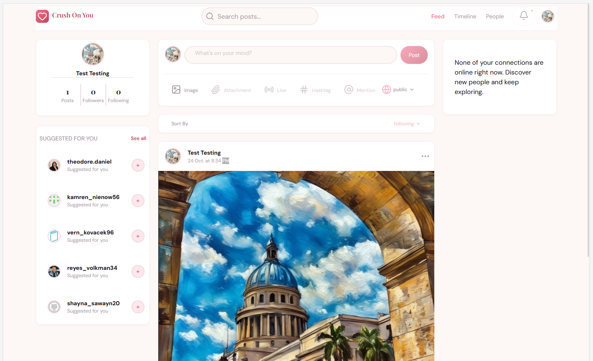
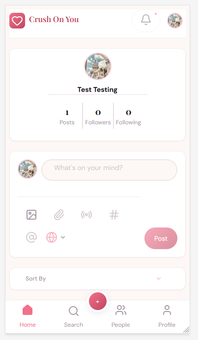
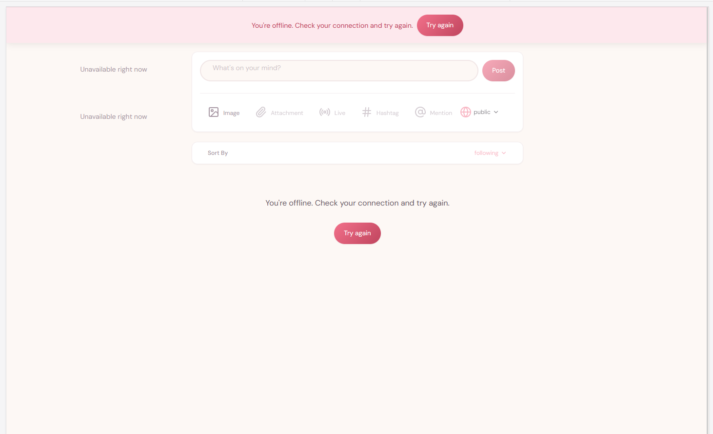

# Crush On You

A social networking app built as a frontend portfolio project: React 19, Vite,
TanStack Query v5 and React Router v6, on top of a Node/Express/MongoDB REST API.

[Leer en español](./README.es.md)

<!-- ***Demo:**  URL here -->

## Screenshots

| Desktop | Mobile |
|---|---|
|  |  |

Offline state: a single global banner, compact placeholders in secondary blocks
and a retry action in the main content.



## Features

- ** Authentication: register and log in with JWT; edit profile and upload an avatar.
- ** Posts: create text posts with one image, like, bookmark, and delete your own.
- ** Social graph: follow and unfollow, followers and following lists, and
suggestions (built from the first page of users only).
- ** Feed and timeline: the feed shows your posts and those of the people you
follow; a timeline shows one user’s posts. Both use infinite scroll.
- ** Search: posts (infinite scroll) and people (paginated). The query is kept
in the URL, and so is the page for people results.
- ** Responsive layout: three columns from 1024px. Below that, a bottom
navigation, a floating create button that opens the composer in a dialog, and a
toggleable search bar.
- ** Resilient states: skeletons, empty states, offline and server-error
handling, and retry actions for data loading.
- ** Accessibility: focus management in dialogs and search, live regions,
keyboard-friendly navigation and aria-expanded on toggles.

## Project status

This is a portfolio project, not a product. Some features are intentionally
disabled with a “coming soon” tooltip (attachments, live, hashtags, mentions,
notifications, friends-only visibility) because the backend does not support
them. See [Known limitations](#known-limitations).

## Tech stack

| Area | Technology |
|---|---|
| UI | React 19, Vite |
| Server state | TanStack Query v5 (`useInfiniteQuery`, optimistic mutations for likes and bookmarks) |
| Routing | React Router v6 |
| Styling | Plain CSS: custom properties as design tokens, BEM-style naming, mobile-first |
| Testing | Vitest |
| Backend | Node.js, Express, MongoDB Atlas, Cloudinary (from a tutorial, minimally modified) |

## Architecture

```
pages → components (ui / molecules / organisms) → hooks → services/api → adapters
```


- ** Components are presentational. They never call TanStack Query or API
functions. A parent consumes a hook and passes data and callbacks down.
- ** Hooks absorb complexity. Data hooks live in hooks/. Orchestration hooks
(for example, usePeoplePage, useCreatePostDialog) live next to the feature
they belong to, and move to hooks/ only when they become cross-cutting.
- ** Adapters isolate the backend. Raw backend shapes are only imported by
adapters, so hooks and components never see them. The backend was not changed
to fit the UI: mismatches are resolved in the frontend.
- ** One source of truth: query keys, URL params (search text and page), design
tokens, and environment access (services/config.js is the only file that
reads import.meta.env).

## Design decisions

- ** Normalized errors. Every failure becomes an ApiError with a code
(NETWORK, SERVER, INVALID_CREDENTIALS…). Messages live in a single map
and are never taken from the backend response, which is in Spanish and has no
stable error codes.
- ** List states have a strict priority: cached data, offline, error, empty
(only after a successful request), loading. This removed false “no posts”
messages while offline or while a query was disabled. One documented
exception: the backend answers 404 for a user with no posts, and the
frontend treats that case as an empty list.
- ** Offline vs server down. A device without connection and a server that
fails are different problems: one global banner, compact placeholders in
secondary blocks, and a full message with retry in the main content.
- ** A single 1024px breakpoint switches navigation and columns. Short landscape
phones get their own rules, so a post stays visible.
- ** Accessibility as a requirement: a generic modal with focus trap and focus
return, live regions, and focus handling when the mobile search closes.

*

Requirements: Node.js 18 or later (20 LTS recommended), a MongoDB Atlas database
and a Cloudinary account.

### 1. Backend

```bash
cd api-rest-red-social
npm install
copy .env.example .env     # macOS/Linux: cp .env.example .env
npm run dev
```

Fill in `.env` with your `MONGO_URI`, the three `CLOUDINARY_*` values and a
`JWT_SECRET`. The API listens on port **3900** (fixed in `index.js`).
`JWT_SECRET` must be a long random string; never reuse one that has been
committed.

`database/connection.js` forces the DNS servers to `8.8.8.8` and `1.1.1.1` so
Atlas resolves on restrictive networks.

Use `npm start` (plain `node`) for production.

#### Demo data (optional)

```bash
npm run seed
```

> **Warning:** the seed **deletes all users, posts and follows** in the database
> that `MONGO_URI` points to. Use a throwaway database, never the deployed one.

It creates 10 fake users (password 123456), follow relationships, and 5 posts
per user with likes and comments. Post images are picsum. photos URLs, so
nothing is uploaded to Cloudinary. Emails are random: register your own account
to log in.

### 2. Frontend

From the repository root:

```bash
npm install
copy .env.example .env     # macOS/Linux: cp .env.example .env
npm run dev
```

`VITE_API_URL` defaults to `http://localhost:3900/api`.

### Scripts

| Script | What it does |
|---|---|
| Script | What it does |
|---|---|
| `npm run dev` | Development server |
| `npm run build` / `npm run preview` | Production build and local preview |
| `npm run dev:demo` / `npm run build:demo` | Same, with simulated user presence |
| `npm run test:run` | Unit tests (Vitest) |
| `npm run lint` | ESLint (the tutorial backend is excluded) |

**Do not deploy the output of `build:demo`:** it shows invented presence.

## Testing and quality

Tests cover the error normalization (ApiError), where a silent failure was
most likely. The project does not aim for broad coverage; the rest of the
behaviour was checked manually at each step. npm run lint finishes with 0
errors.

## Known limitations

- ** Presence is simulated in demo mode: the backend has no presence system.
- ** One image per post; friends-only visibility, attachments, live, hashtags,
mentions and notifications are disabled with a “coming soon” tooltip.
- ** Comments exist in the API but aren't in the frontend yet.
- ** Messages were dropped from the MVP (no backend support).
- ** Suggestions reuse the general user list (first page of 5, filtered). There
is no suggestions endpoint.
- ** Failed likes, bookmarks, and follows roll back silently: the optimistic
update is reverted, but no message is shown.
- ** Empty timeline: the backend answers 404 for a user with no posts, which
the frontend maps to an empty list. For the same reason, an invalid token
(also a 404) can look like an empty feed.
- ** Backend: tutorial code, not linted on purpose. A duplicate email returns
200 with no user (handled in the frontend), CORS is open, and some
dependencies are outdated (multer 1.x is deprecated).
- ** No automatic logout when the session expires.
- ** Search sends a request per keystroke (no debounce).
- ** Disabled buttons with tooltips are not reachable by keyboard.
- ** The mock client (VITE_USE_MOCK) is out of sync with the real routes.

## Credits

The backend is based on a tutorial by Victor Robles (MIT) and was minimally
modified. The frontend is original work.


